# Frame

[](https://github.com/khadishoo/frame/actions/workflows/ci.yml)

**Пространство для творческих проектов** — рисунков, музыки, видео, фото, сценариев и кода.
Поймать идею, разложить проект на задачи, двигать их по доске и видеть, как работа доходит до конца.

Full-stack приложение: React SPA + REST API на Express и PostgreSQL. Портфолио-проект, версия alpha.

<picture>
  <source media="(prefers-color-scheme: dark)" srcset="docs/screenshots/dashboard-dark.png" />
  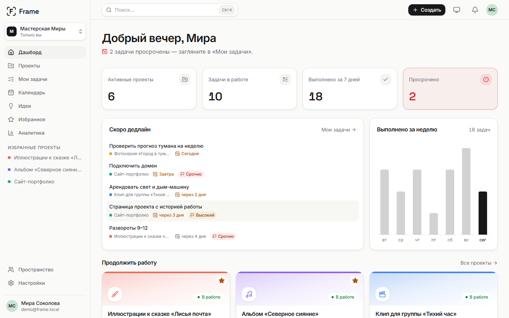
</picture>

> **Посмотреть без регистрации:** на странице входа — кнопка **«Войти как демо»**
> (аккаунт иллюстратора и музыканта Миры: 10 проектов, 60 задач, идеи и активность за две недели).
> Публичная ссылка появится после деплоя (этап 11).

## Возможности

- **Проекты** семи творческих типов — у каждого свой цвет и иконка; категории, теги, статусы,
  дедлайны, архив; фильтры и сортировка живут в адресе страницы.
- **Kanban-доска** с перетаскиванием мышью, пальцем и с клавиатуры; прогресс проекта
  пересчитывается сразу. Таблица задач с сортировкой, «Мои задачи» по срокам.
- **Идеи и заметки** на Markdown с автосохранением; быструю идею открывает клавиша **N** с любой
  страницы; идею можно одной кнопкой превратить в проект.
- **Дашборд**: сводка, просрочки, ближайшие дедлайны, график выполненного за неделю.
- **Поиск** по проектам, задачам и заметкам — **Ctrl+K**, с подсветкой совпадений.
- **Избранное**, светлая и тёмная темы (тема хранится в профиле), адаптивная вёрстка от 375 px.

## Скриншоты

| | Светлая тема | Тёмная тема |
|---|---|---|
| Доска | 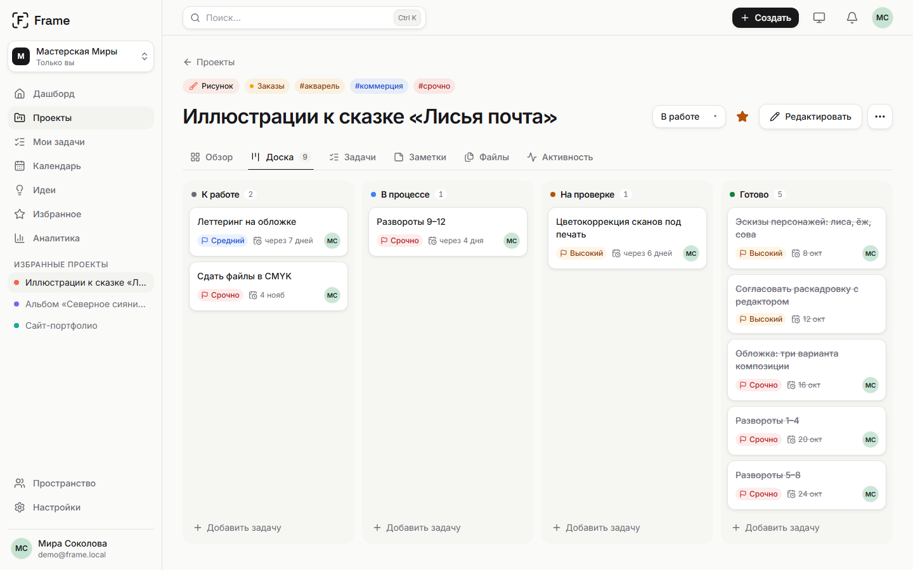 | 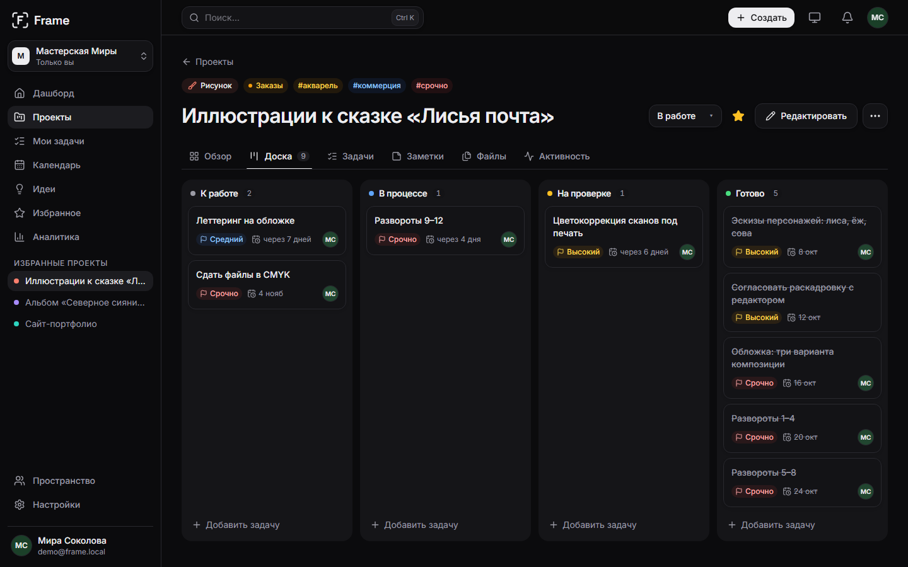 |
| Проекты | 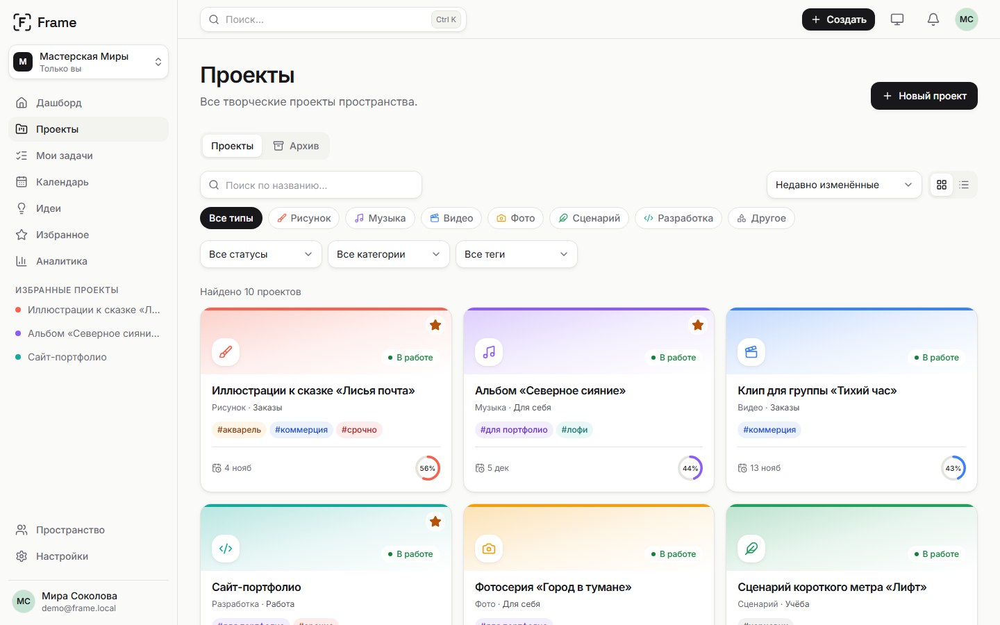 | 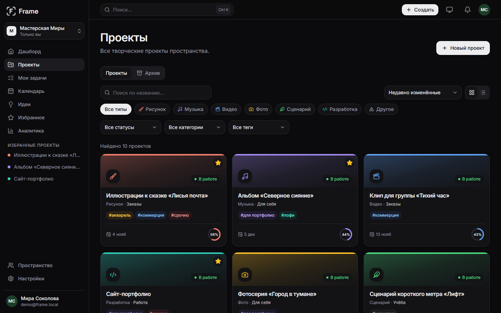 |
| Идеи | 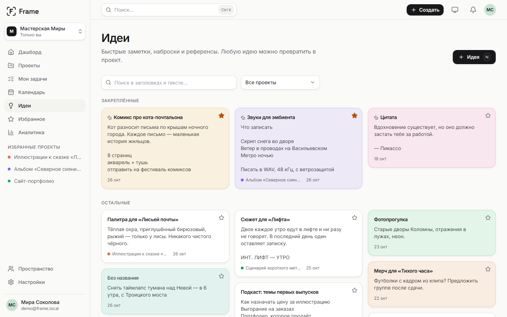 | 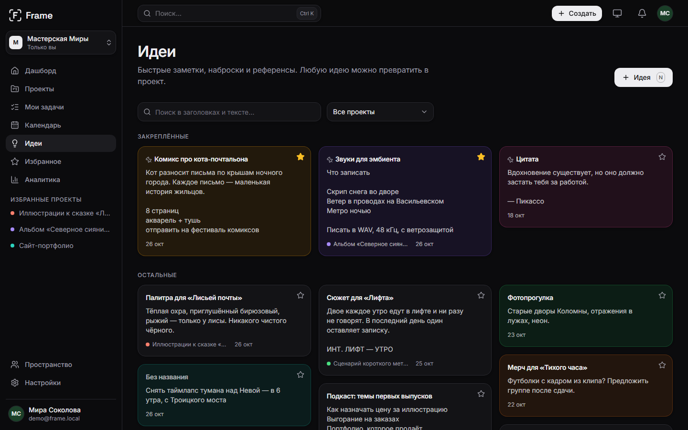 |
| Лендинг | 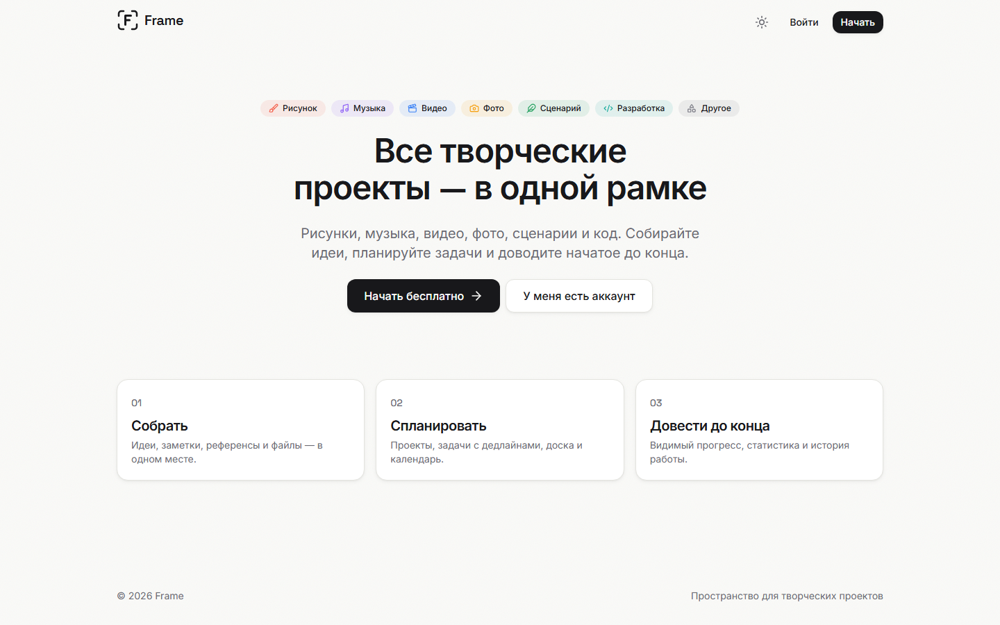 | 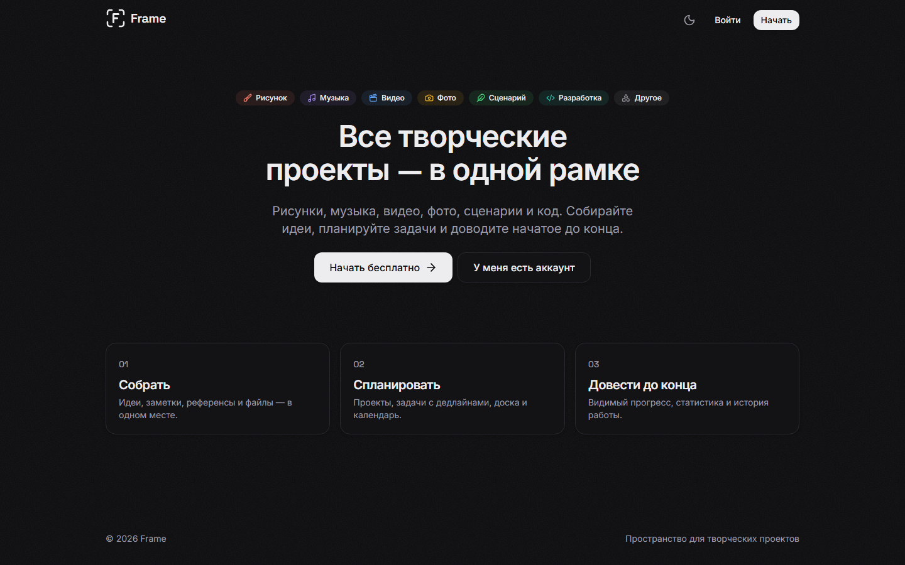 |

<p align="center">
  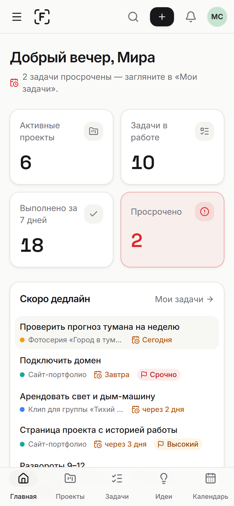
  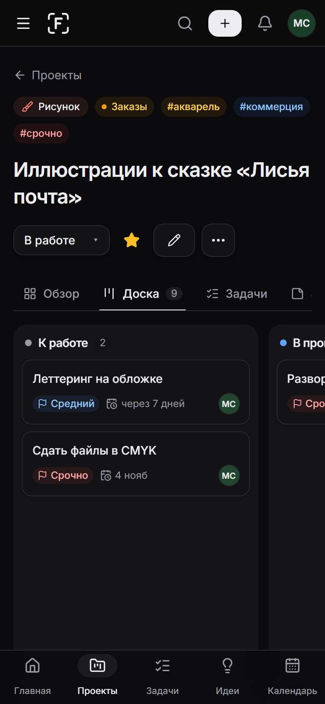
</p>

## Стек

| | |
|---|---|
| **Клиент** | React 19, Vite, Tailwind CSS 3, React Router 7, TanStack Query 5, Zustand, React Hook Form + Zod, dnd-kit, framer-motion, react-markdown |
| **Сервер** | Node.js 22, Express 5, PostgreSQL 17, Knex, Zod 4, argon2, JWT, pino, helmet |
| **Тесты** | Vitest + Supertest (API на отдельной базе), Vitest + Testing Library (клиент), Playwright (E2E) |
| **Качество** | ESLint 9, Prettier, GitHub Actions: lint, тесты, сборка, E2E, `npm audit` |

## Архитектура

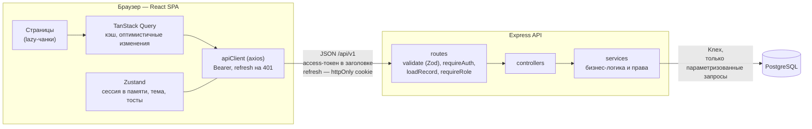

Бэкенд разложен по слоям **routes → controller → service → db**: маршрут описывает URL и
проверки, контроллер разбирает запрос, сервис решает и проверяет права. Каждый ресурс ищется
только через членство пользователя в пространстве, поэтому чужая запись неотличима от
несуществующей (404, а не 403 — без утечки факта существования).

<details>
<summary><b>Схема базы данных</b></summary>

```mermaid
erDiagram
  users ||--o{ refresh_tokens : "сессии"
  users ||--o{ workspace_members : ""
  workspaces ||--o{ workspace_members : "роли owner…viewer"
  workspaces ||--o{ projects : ""
  workspaces ||--o{ categories : ""
  workspaces ||--o{ tags : ""
  workspaces ||--o{ notes : ""
  categories |o--o{ projects : ""
  projects ||--o{ project_tags : ""
  tags ||--o{ project_tags : ""
  projects ||--o{ tasks : ""
  projects |o--o{ notes : "идея → проект"
  users ||--o{ favorites : "project | note"

  users { uuid id citext email text password_hash citext username text_arr creative_types }
  refresh_tokens { uuid id text token_hash timestamptz revoked_at timestamptz expires_at }
  projects { uuid id enum type enum status date due_date timestamptz archived_at }
  tasks { uuid id enum status enum priority double position date due_date timestamptz completed_at }
  notes { uuid id text title text content bool is_pinned }
  favorites { uuid user_id enum entity_type uuid entity_id }
```

</details>

```
client/   React SPA: app/ (роутер, провайдеры), components/ui (UI-кит), features/<раздел>
server/   REST API: modules/<ресурс> (routes, controller, service, schema), миграции и сид Knex
e2e/      Playwright: сценарий нового пользователя и демо-вход
```

## Интересные решения

**Refresh-токены с ротацией и поимкой кражи.** Access-токен живёт 15 минут и хранится только в
памяти вкладки — XSS не найдёт его в `localStorage`. Refresh — случайные 48 байт в httpOnly-cookie,
в базе лежит лишь SHA-256. Каждый refresh выдаёт новый токен и отзывает старый; если отозванный
токен пришёл снова, значит, его кто-то скопировал — сервер завершает все сессии пользователя.
На клиенте десяток одновременных ответов 401 запускают **один** refresh (общий промис), а
`navigator.locks` не даёт двум вкладкам обновиться одновременно и «украсть» токен друг у друга.

**Порядок карточек на доске без перенумерации.** Клиент сообщает только «место в колонке», а
сервер ставит карточке позицию посередине между соседями (1000 и 2000 → 1500). Когда промежуток
становится меньше 0.001, колонка перенумеровывается одним `UPDATE … row_number()`. Перемещения в
одном проекте идут по очереди под `SELECT … FOR UPDATE` строки проекта — две вкладки не перепутают
порядок. На клиенте ход пишется в кэш синхронно, поэтому карточка не «прыгает» назад до ответа.

**Избранное без внешнего ключа — и без мусора.** В избранное попадают и проекты, и заметки, так что
у ссылки нет одной таблицы для `FOREIGN KEY`. Висячих записей не остаётся благодаря триггеру
PostgreSQL: он удаляет отметки, когда удаляют проект или заметку — в том числе каскадом вместе
с целым пространством.

**Часовые пояса в статистике.** Дашборд получает пояс браузера (`?tz=Europe/Moscow`, проверка через
`Intl`), «сегодня» считается в нём, а график недели строится через `generate_series` и
`completed_at AT TIME ZONE tz` — пустые дни приходят нулями. Даты без времени (дедлайны) приходят
строкой `YYYY-MM-DD`, чтобы дедлайн не уехал на день из-за сдвига пояса.

**Клавиша N в любой раскладке.** Горячие клавиши проверяют `event.code === 'KeyN'` (физическую
клавишу), а не `event.key`: в русской раскладке та же клавиша — «т», и обычная проверка молча
не сработала бы. Так же устроен Ctrl+K. Клавиша не срабатывает в полях ввода и поверх открытых окон.

**Загрузка по частям.** Каждая страница — отдельный чанк с React.lazy и скелетоном; доска с dnd-kit
и редактор с Markdown грузятся, только когда их открыли; движок анимаций подгружается после первой
отрисовки (`LazyMotion`). Стартовый JavaScript: 936 → 521 КБ (gzip 297 → 170).

**Безопасность в мелочах.** Строгая CSP: у API — `default-src 'none'`, у SPA — только свои скрипты
плюс sha256-хэш инлайн-скрипта темы. Markdown рендерится в React-элементы через `rehype-sanitize`,
без `dangerouslySetInnerHTML`. Лимиты запросов на вход, регистрацию и refresh. Пароль демо-аккаунта
сменить нельзя — иначе один посетитель сломал бы демо для всех.

**Ошибки, с которыми можно что-то сделать.** У каждого запроса — скелетон, пустое состояние и
ошибка с кнопкой «Повторить»; при потере связи — один тост «Нет соединения с сервером», а не десять;
упавшая страница не роняет сайдбар; после нового релиза устаревшая вкладка предлагает обновиться.

## Качество

- **Тесты:** 174 теста API (авторизация, права и IDOR, валидация, порядок на доске, конвертация,
  статистика), 145 тестов клиента, 2 E2E-сценария: от регистрации до выхода с перетаскиванием на
  доске и демо-вход.
- **Lighthouse** (мобильный профиль с троттлингом / десктоп) на лендинге, входе, дашборде, проектах и
  доске: Performance 93–100, Accessibility 100, Best Practices 100 — в обеих темах.
- **CI** на каждый push: lint и Prettier, тесты API на PostgreSQL 17, тесты и сборка клиента,
  Playwright на отдельной базе, `npm audit`.

## Запуск

Нужны Node.js 22+ и PostgreSQL 17.

```powershell
Copy-Item server/.env.example server/.env   # 1. впишите пароль PostgreSQL в DATABASE_URL
npm run setup                               # 2. зависимости, база frame_dev, миграции, демо-данные
npm run dev                                 # 3. API :4000 + клиент :5180
```

Откройте http://localhost:5180 и нажмите «Войти как демо». `npm run setup` сам создаст базу и
сгенерирует `JWT_ACCESS_SECRET`, если он пуст; повторный запуск безопасен.

```powershell
npm run test       # тесты API и клиента (база frame_test создаётся сама — нужен TEST_DATABASE_URL)
npm run test:e2e   # Playwright: поднимет API и сборку клиента на чистой базе frame_e2e
npm run lint
```

## Дальше

Деплой и публичная ссылка (этап 11), затем файлы и календарь (v1.1), совместные пространства,
комментарии и уведомления (v1.2), аналитика (v1.3).
